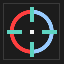
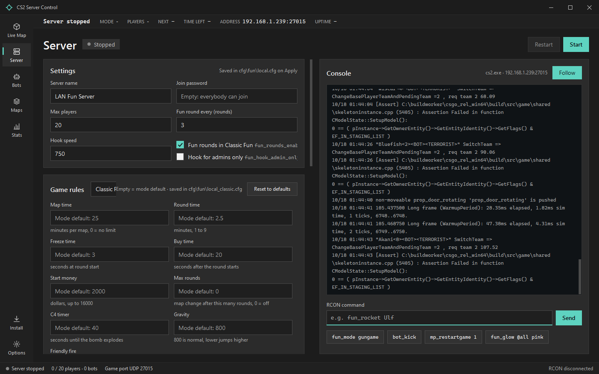
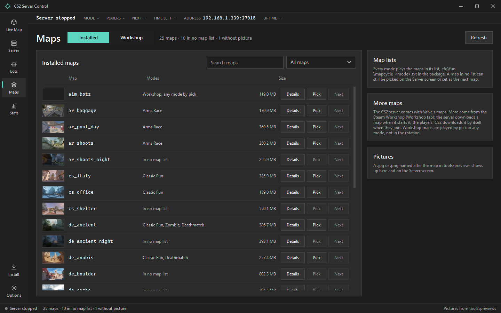
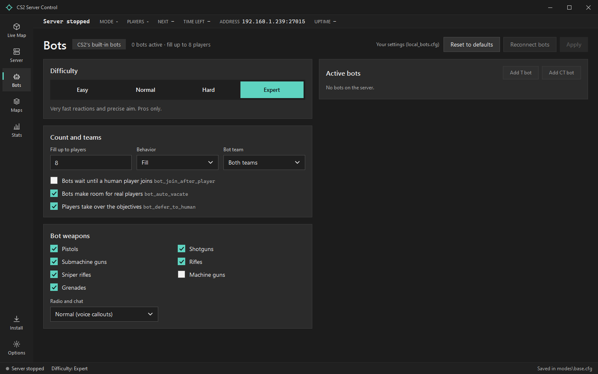
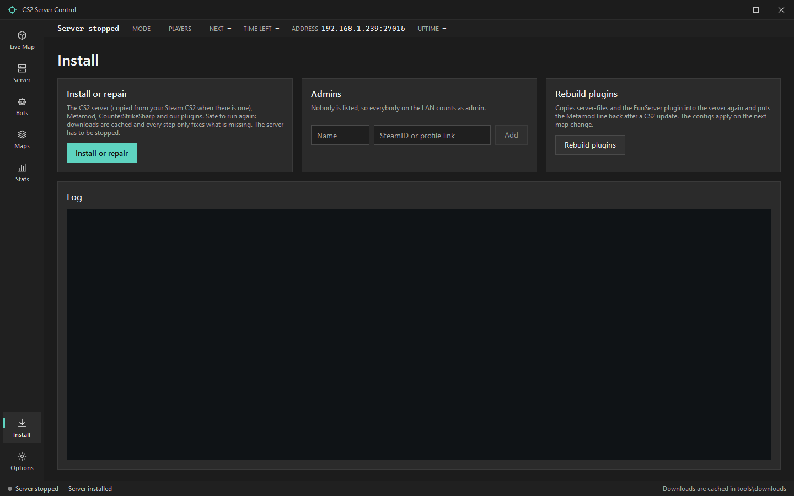

<div align="center">



# CS2 LAN Fun Server

**A Counter-Strike 2 fun server for your LAN party, installed and run from one Windows app.**

[](CHANGELOG.md)


[](LICENSE)


[Quick start](#quick-start) ·
[Modes](#modes) ·
[For the players](#for-the-players) ·
[How it works](#how-it-works) ·
[Development](#development)

</div>

---

It started at a LAN party: after twenty years, straight back to Counter-Strike 1.6. That evening
deserved a proper server, and the **CS 1.6 LAN Fun Server** came out of it, with a hook, zombies,
fun rounds and a live 3D map of the match. This project is its sister for **Counter-Strike 2**: the same window and the same fun,
ported to Valve's current game.

**CS2_SERVER_CONTROL.exe** installs the CS2 dedicated server, the plugin system and the fun
plugin, starts and stops the server, and shows every player on a live 3D map while you play on
the same PC. No config files to edit, no console commands to remember, no binds for the players.

<a href="docs/images/screen-server.png">
  
</a>

## Contents

- [Features](#features)
- [Screenshots](#screenshots)
- [Status](#status)
- [Known issues](#known-issues)
- [Quick start](#quick-start)
- [Requirements](#requirements)
- [Modes](#modes)
- [For the players](#for-the-players)
- [Workshop maps](#workshop-maps)
- [Settings and the package defaults](#settings-and-the-package-defaults)
- [After a CS2 update](#after-a-cs2-update)
- [How it works](#how-it-works)
- [Development](#development)
- [Credits](#credits)
- [Legal](#legal)
- [License](#license)

## Features

- **One app for everything**: install or repair, start and stop, change the mode and the map,
  kick, slay and glow players, and watch the server console, all from one window.
- **Five modes**: Classic Fun, Arms Race, Deathmatch, Zombie and Deathrun, each with its own map
  list that the plugin turns into a rotation CS2 itself does not have.
- **Live 3D map**: every player as a marker on a wireframe of the map, read straight from the
  map's world collision; kill feed with the game's own weapon icons, follow mode, top view.
- **Fun plugin** for CounterStrikeSharp: hook, grab, parachute, fun rounds, kill streaks, a mode
  vote in chat and an outline glow through walls.
- **Bots** with CS2's built-in skills and a screen that says when they are waiting for a human.
- **Workshop maps** by link: paste the address of a Workshop page, the server downloads the map
  and every player's CS2 fetches it on join.
- **Stats** for the evening from the plugin's own log: leaderboard with headshots and best streak,
  and details per player.
- **Admins** from the Install screen; while nobody is listed, everybody counts as admin, which is
  what a LAN usually wants.
- **No 60 GB download** when CS2 is already in the PC's Steam library: the first install copies it
  and lets SteamCMD fetch only what differs.
- **Never steals the focus**: the server runs on a hidden desktop, so the host can play on the
  same PC.

## Screenshots

| Maps | Bots |
|---|---|
| [](docs/images/screen-maps.png) | [](docs/images/screen-bots.png) |
| **Maps**: every installed map with its picture and modes; Workshop maps on their own tab. | **Bots**: CS2's built-in bots, from difficulty to the weapons they may buy. |

| Install |
|---|
| [](docs/images/screen-install.png) |
| **Install**: one button for the server, Metamod:Source, CounterStrikeSharp and the fun plugin, plus the admin list. |

## Status

> [!NOTE]
> **Early version, tested on one machine.** Install, start, stop, all five modes, bots, the live
> 3D map, the fun plugin and Workshop maps ran on a real CS2 dedicated server on Windows 10 Pro,
> with bots. The in-game feel with human players on a LAN is still being tested.
> Reports from other setups are welcome.

Tested on a real server, with bots:

- the install (Steam copy, SteamCMD, Metamod:Source, CounterStrikeSharp, the FunServer plugin)
- the mode switch and the config order on every map, the map rotation, next map and time left
- the live feed: players, kills with weapon and headshot, shots, the glow colour
- fun rounds (knives, AWP, Juggernaut, Deagle, HE war), the admin commands
- zombie infection and HP, the deathrun trapper and knives
- a Workshop map downloaded and started by the server

Not tested yet: the hook, grab and parachute by a human, the `!mode` vote, the feel of the speed
round and of the zombies, and players joining over the LAN from other PCs.

## Known issues

- **CSTV opens on port 0 on the first map after a start**; from the next map change on it uses
  UDP 27020 as configured.
- **The plugin's `[FunServer]` lines do not show in the console tab.** CS2 keeps them out of
  `console.log`; the window gets the active mode from the live feed instead.
- **A CS2 update can break the plugin system** until Metamod:Source or CounterStrikeSharp ship a
  matching version. See [After a CS2 update](#after-a-cs2-update).

## Quick start

1. Download the release zip and unpack it to a permanent folder, for example
   `D:\Games\CS2-FunServer`.
2. Start `CS2_SERVER_CONTROL.exe`. Before the first install it opens on the Install screen.
3. Press **Install or repair**. It sets up the CS2 dedicated server through SteamCMD (about
   60 GB, or a copy of your Steam CS2), Metamod:Source, CounterStrikeSharp, the FunServer plugin
   and the configs of this package.
4. Press **Start** on the Server screen. The bar at the top shows the address, for example
   `192.168.1.50:27015`. Players join from the CS2 console with:

```text
connect 192.168.1.50:27015
```

## Requirements

**Server PC**: Windows 10 or 11, 4 or more CPU cores, 8 GB RAM, about 70 GB free disk space on an
SSD, internet for the install and for Steam.

**Every player**: a PC that runs CS2 (Windows 10, 4-core CPU, 8 GB RAM, a DirectX 11 graphics card
with 1 GB VRAM, about 85 GB disk), CS2 installed through Steam before the party, and internet at
the party, because CS2 and the Steam Workshop need Steam online.

## Modes

| Mode | What it plays like |
|---|---|
| **Classic Fun** | Casual rules with bunny hopping, hook, grab, parachute and a fun round every few rounds. |
| **Arms Race** | Valve's GunGame: a new weapon with every kill. |
| **Deathmatch** | Instant respawn, with the hook. |
| **Zombie** | Everybody starts human; after 10 seconds the first zombies turn. A zombie hit infects, only the last human really dies. Zombies glow red, humans blue, through walls. |
| **Deathrun** | One trapper against everybody, knives only. Needs deathrun maps from the Workshop. |

To change the mode during the party, type `!mode` in chat: everybody votes for 20 seconds by
typing the number of a mode. `!help` shows the rules of the running mode and the controls.

## For the players

No binds needed, everything sits on keys CS2 already has:

| | |
|---|---|
| **Hook** | Hold F (inspect weapon) while aiming at a wall: a glowing rope pulls you there. Classic and Deathmatch. |
| **Parachute** | Hold E while falling. |
| **Grab** | Admins hold E while aiming at a player to lift them; left click throws. |
| **Streaks** | Every 5 kills in a row: a gold glow and +50 HP; at 10 also a rocket jump. |
| **Fun rounds** | Every third round in Classic: knives only, AWP only, low gravity, speed, headshots only, one-bullet Deagle, HE war, ghosts or a Juggernaut. The host can force one on the Server screen. |

## Workshop maps

On the Maps screen, Workshop tab, **Browse the Workshop** opens Steam's Workshop in the browser.
Copy the address of a map page, paste it into the box and press **Add**. The map then shows on the
Server screen in every mode. The server downloads it the first time it starts it, and the players'
CS2 downloads it by itself when they join. Workshop maps are played by pick; the rotation stays on
Valve's maps.

## Settings and the package defaults

The package configs keep the package defaults and the app never writes them. Everything the host
changes in the window goes into `cfg\fun\local*.cfg` next to them, survives every install, and
every screen has a way back to the defaults.

On every map the plugin runs, in this order:

1. `cfg\fun\modes\base.cfg`, the package defaults, which reset every cvar a mode may change
2. `cfg\fun\local_bots.cfg`, the host's bot settings
3. `cfg\fun\modes\<mode>.cfg`, the mode
4. `cfg\fun\local.cfg` and `cfg\fun\local_<mode>.cfg`, the host's own settings

## After a CS2 update

Valve updates CS2 often, and every update replaces `gameinfo.gi`. The window puts the Metamod
search path back before every start. If the fun plugins still do not load, run **Install or
repair** again, or wait for a CounterStrikeSharp update. Arms Race, Deathmatch and Casual also
work without plugins.

## How it works

```text
CS2_SERVER_CONTROL.exe  --start, RCON (TCP 27015)-->  cs2.exe -dedicated
        ^                                               |  Metamod:Source
        |                                               |  CounterStrikeSharp
        +------ live feed (UDP 127.0.0.1:27090) --------+  FunServer plugin
        +------ A2S query (UDP 27015) ------------------+
```

- The app starts `cs2.exe` on a hidden desktop and talks to it with Source RCON over TCP on the
  game port. It polls with the A2S query instead of RCON, because the server logs every RCON
  command. The console tab tails `console.log`, since CS2's RCON replies carry no output.
- The FunServer plugin sends a live feed to the app on `127.0.0.1:27090`: players five times a
  second, every kill and shot, time left and the next map. The line format is the CS 1.6
  project's, extended at the end of lines.
- The app writes the active mode into `cfg\fun\active_mode.txt`; the plugin reads it on every map
  start, runs the configs and sets `nextlevel` from the mode's map list.

| Folder | Content |
|---|---|
| `app\Cs2ServerControl\` | the WPF app (.NET 10, MVVM Toolkit, HelixToolkit for the 3D map) |
| `app\Cs2ServerControl.Tests\` | xUnit tests, including a fake RCON server |
| `server-plugins\FunServer\` | the CounterStrikeSharp plugin: live feed, mode configs, fun features, admin commands |
| `server-files\csgo\` | the config overlay copied into the server on every install |

## Development

Requirements: Windows and the .NET 10 SDK.

```bash
dotnet test app\Cs2ServerControl.Tests
```

```bash
dotnet publish app\Cs2ServerControl -c Release
```

The publish runs the tests first, then builds the FunServer plugin into `plugins\` and the exe into
the repository root. Add `-p:BuildReleaseZip=true` to also pack `release\CS2-FunServer.zip`.

Rules worth knowing before a change:

- Edit `server-files\`, `server-plugins\` and `app\`, never `server\`: the installer overwrites
  the configs and plugins there on every run.
- Every cvar a mode config or the window changes is also reset in `modes\base.cfg`, so it never
  leaks into the next map.
- Every download is pinned to an exact version in `Install\InstallComponents.cs`, and the plugin's
  `CounterStrikeSharp.API` package matches the installed CounterStrikeSharp.
- The code follows [.editorconfig](.editorconfig): four spaces, K&R braces, braces on every block.

Branches: `main` holds the releases, each one tagged `vMAJOR.MINOR.PATCH`; work happens on
`develop`. See the [changelog](CHANGELOG.md).

## Credits

Built on the work of others, with thanks:

- [Metamod:Source](https://www.sourcemm.net/) by AlliedModders
- [CounterStrikeSharp](https://github.com/roflmuffin/CounterStrikeSharp) by roflmuffin and contributors
- [ValveResourceFormat](https://github.com/ValveResourceFormat/ValveResourceFormat), which reads the maps and icons
- [HelixToolkit](https://github.com/helix-toolkit/helix-toolkit), which draws the 3D map
- [SharpVectors](https://github.com/ElinamLLC/SharpVectors), [SharpCompress](https://github.com/adamhathcock/sharpcompress) and the [.NET Community Toolkit](https://github.com/CommunityToolkit/dotnet)

And to everybody at that LAN party, twenty years on.

## Legal

Counter-Strike, Counter-Strike 2 and Steam are trademarks of Valve Corporation. This project is
not affiliated with or endorsed by Valve. It ships no game files: the installer downloads the CS2
dedicated server through Valve's SteamCMD, and every player needs their own copy of CS2 from
Steam. Metamod:Source and CounterStrikeSharp are downloaded at install time from their official
releases and keep their own licenses.

## License

The CS2 LAN Fun Server is released under the [MIT License](LICENSE).
Copyright (c) 2026 DaRealHansForSure.
